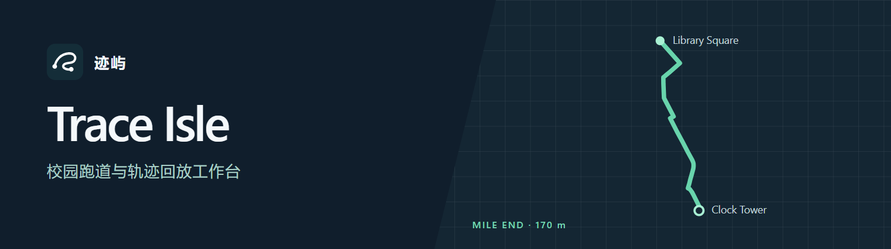
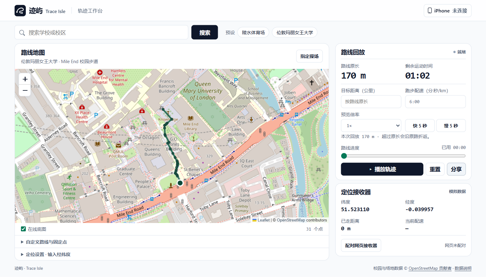

[](https://softbread1217.github.io/trace-isle/)

# 迹屿 · Trace Isle

在地图上选一条校园跑道，输入距离和配速，观察位置怎样随时间变化。网页可以独立回放，也可以把读数同步到 iPhone 浏览器，或通过 Windows USB 助手在真机上测试定位。

**[打开工作台](https://softbread1217.github.io/trace-isle/)**　·　**[体验伦敦校园步道](https://softbread1217.github.io/trace-isle/?preset=mile-end)**　·　**[下载 Windows 助手与源码](https://github.com/SoftBread1217/trace-isle/archive/refs/heads/main.zip)**

## 从一段校园步道开始

伦敦玛丽女王大学示例取自 **Mile End 校区**。路线从钟楼东侧的步道出发，经过 Queens’ Building 一侧，到达 Library Square，地图长度约 **170 米**。点开下图即可载入路线，再点「播放轨迹」观察地图上的位置和右侧读数。切换到「陵水体育场」即可体验逆时针绕圈。

[](https://softbread1217.github.io/trace-isle/?preset=mile-end)

地点参考[伦敦玛丽女王大学官方校园地图](https://www.qmul.ac.uk/about/howtofindus/mileend/)。伦敦示例、封面轨迹和截图中的地图数据来自 [© OpenStreetMap 贡献者](https://www.openstreetmap.org/copyright)。

## 用自己的学校或路线

| 想做什么 | 在工作台里怎么操作 |
| --- | --- |
| 找到校内操场 | 搜学校名、简称或校区，例如「北邮」或「浙大 紫金港」。选校区和场地，核对预览后点「使用这条跑道」。 |
| 手动指定操场 | 点「指定操场」，放大地图并点操场中心，然后拖动控制点调整跑道的位置、朝向与宽度。 |
| 手绘路线或选固定点 | 展开「自定义路线与固定点」。画线至少需两个不同的点，三个点起可以闭合。也可在「定位设置」直接输入经纬度。 |
| 调整距离与配速 | 配速按每公里的分、秒填写，例如 `5:30`。目标距离留空时播放路线原长，超出时闭合跑道继续绕圈，开放路线沿原路折返。 |
| 分享与交换路线 | 点「分享」生成带坐标的链接。较长的路线可导出 GPX；导入支持一段轨迹、一条路线或一组航点，上限为 4,000 个点、2 MB。 |

学校索引和场地数据随网站发布。自动推荐会核对校区边界、场地轮廓和初始路线，园区共享场地另有标注。有地图跑道线时沿线回放；只有场地范围时会提供可调整的估算路线。缺少可靠校界时可以手动指定操场。[校园数据来源与许可](campus-data/README.md)

## 在 iPhone 上使用

**用 Safari 查看网页回放。** 在电脑的「定位接收器」点「配对网页接收器」，用 iPhone 相机扫码，在 Safari 打开并保持两端页面在前台。电脑显示「接收页已连接」后，两端会同步显示位置、累计距离和配速。扫码配对需要网络支持 WebRTC。

**用 Windows 测试 iPhone 系统定位。** 准备 Windows 版 Apple Devices、可传输数据的 USB 线，以及 Python 3.12。助手的连接方式面向 iOS 17.4 及以上，手机需能使用开发者定位服务。

1. 下载并解压上方的 Windows 助手与源码，运行 `Start-Windows-USB.cmd`。首次运行会安装依赖。保持助手运行，打开[本机 USB 控制台](http://127.0.0.1:4179/)。
2. 接好数据线并解锁手机。在控制台右上角打开 iPhone 设置，点「连接 USB iPhone」，根据手机提示信任电脑并开启开发者模式。
3. 载入路线或选好固定点，再打开 iPhone 设置，点「应用到 iPhone」。打开苹果「地图」查看蓝点，播放时位置会随轨迹更新。
4. 测试结束后点「恢复真实定位」，在手机地图确认后断开。意外断线时助手会尝试清除模拟，必要时可重新连接恢复。

<details>
<summary><strong>本地运行、测试与数据说明</strong></summary>

在项目根目录启动网页，然后访问 [localhost:4178](http://127.0.0.1:4178/)。

```sh
python -m http.server 4178 --bind 127.0.0.1
```

运行路线测试：

```sh
node --test tests/route.test.mjs
```

网站从 GitHub Pages 的 `main` 分支根目录发布，无需 npm 构建。GPX 在浏览器中读取，回放采用界面设置的速度。GPX 中的时间戳和高度不参与计算。分享链接包含路线坐标，独立打开时可以自行回放。

在线底图采用 OpenStreetMap 标准彩色地图，关闭底图仍可画线和回放。地图引擎为 [Leaflet 1.9.4](https://leafletjs.com/)，参见 [Leaflet 许可](vendor/LICENSE)。网页接收器使用 [PeerJS](https://peerjs.com/) 公共信令服务，二维码由 qrcode-generator 在本机生成。

</details>
